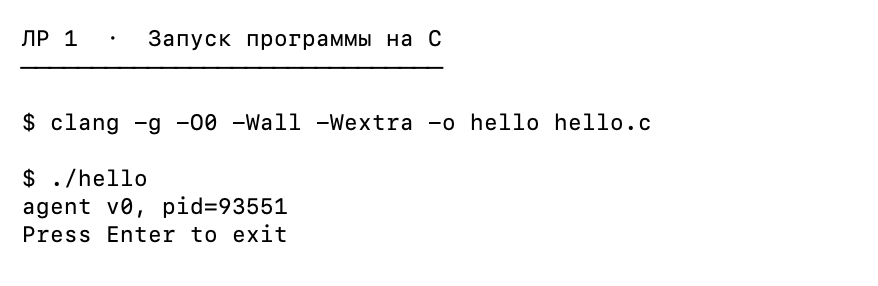
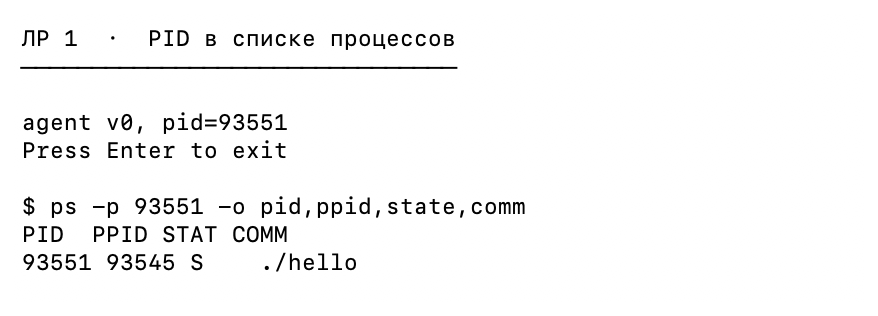
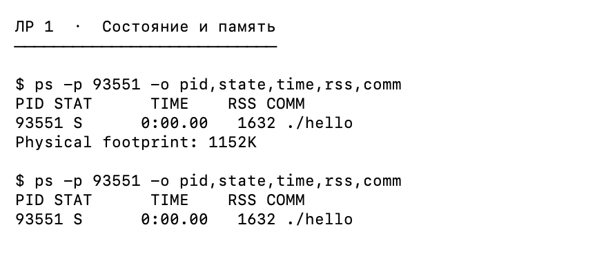
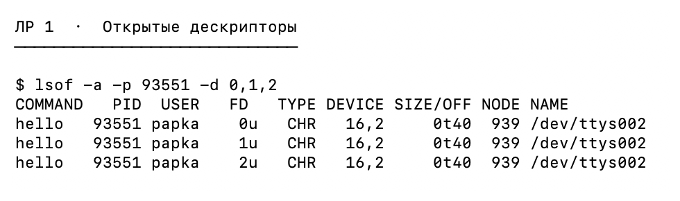
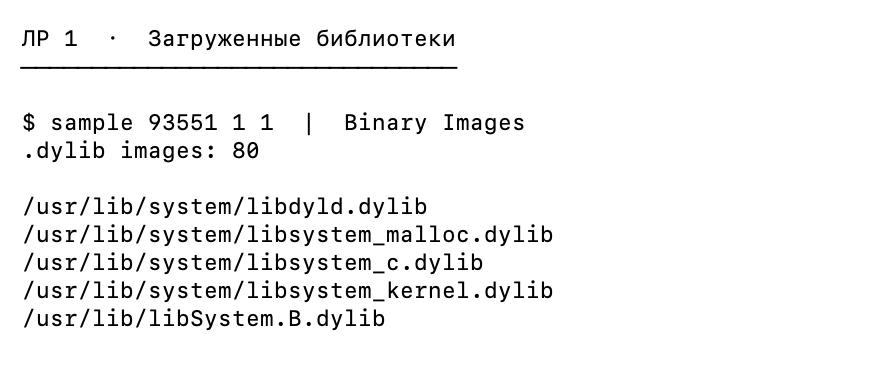
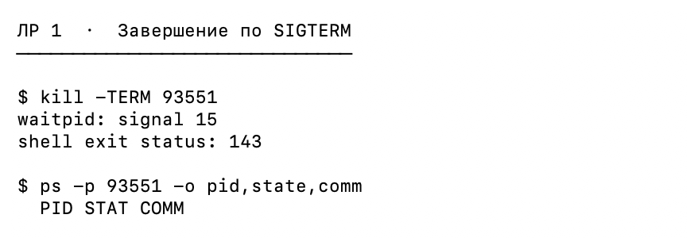
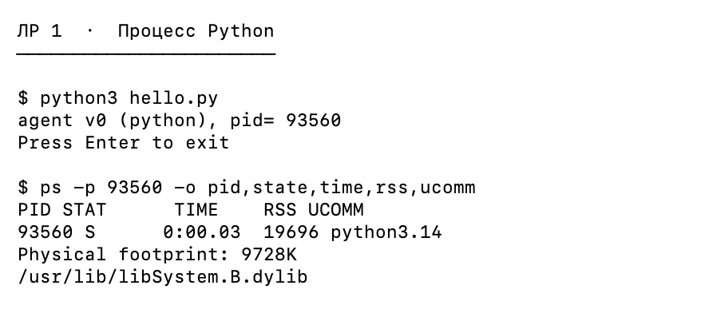
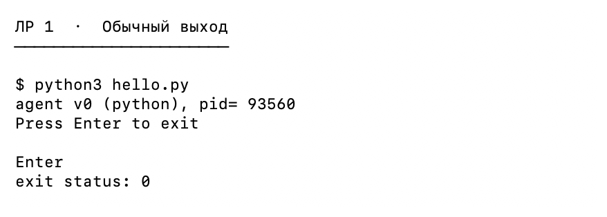

# ЛР 1. Процесс изнутри

Система: macOS 27, Apple Silicon (arm64) · компилятор: Apple clang version 21.0.0 (clang-2100.3.34.2)

## Программа на C
Программа напечатала PID 45455, монитор показал PID 45455.
Память процесса в мониторе: физическая 1,6 МБ (собственная 576 КБ). Процессорное время: 0,00.
Пока программа ждёт Enter, процессорное время не растёт, потому что процесс спит в `getchar()`: он заблокирован в ядре до ввода, и планировщик не выдаёт ему процессор.
Дескрипторов у процесса: 3 (0, 1, 2). Ввод и вывод ведут в `/dev/ttys000` — устройство окна терминала.
Системные библиотеки в процессе: 80 файлов .dylib, среди них `libSystem.B.dylib`, `libsystem_kernel.dylib`, `libsystem_c.dylib`, `libsystem_malloc.dylib`, `libdyld.dylib`.
После завершения из монитора терминал напечатал `zsh: terminated  ./hello`, код завершения 143.

## Программа на Python
Имя процесса в мониторе: Python, PID 45532, память 11,8 МБ.
Памяти больше, чем у программы на C, примерно в 7 раз.
Общая библиотека у программ на C и Python: `libSystem.B.dylib`.
Код завершения при обычном выходе: 0.

## Повторный запуск на Mac, 18 ноября 2026 года

Снимки ниже относятся к повторному запуску в Terminal. Программа на C напечатала PID 93551. В двух снимках ps она спала, процессорное время оставалось 0:00.00. RSS составил 1632 КиБ, физический след по vmmap — 1152 КиБ. Дескрипторы 0, 1 и 2 открыты на /dev/ttys002. В sample видно 80 образов dylib. После SIGTERM процесс исчез из ps, статус для оболочки — 143.

У Python 3.14 PID 93560, RSS 19 696 КиБ и физический след 9728 КиБ. При сравнении одной метрики физический след примерно в 8,4 раза больше, чем у C. Обе программы загрузили libSystem.B.dylib. После Enter Python завершился с кодом 0.

## Помощник ИИ (Р1)

Вопрос: «Объясни программу hello.c по строкам».

getpid() возвращает PID текущего процесса. Вызов getchar() ждёт ввода и не выполняет пустой цикл. Это подтверждают состояние S и два одинаковых замера процессорного времени.

## Снимки терминала

