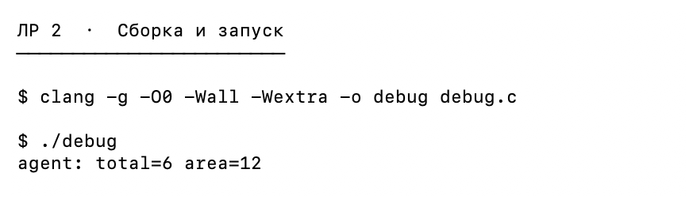
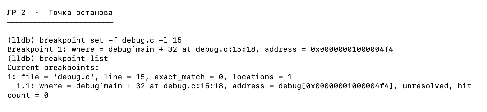
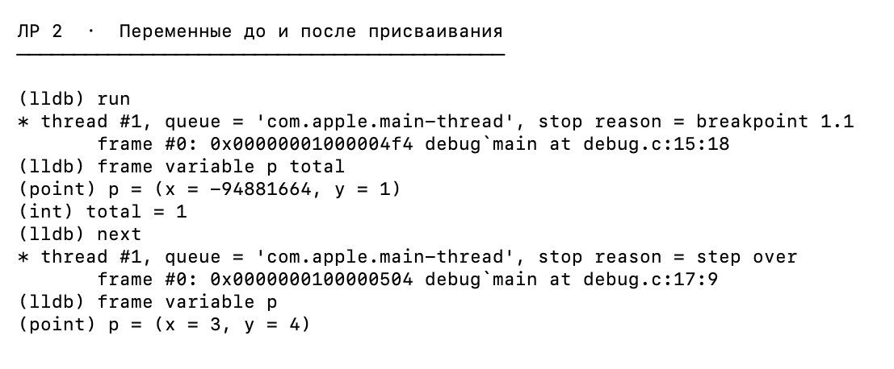
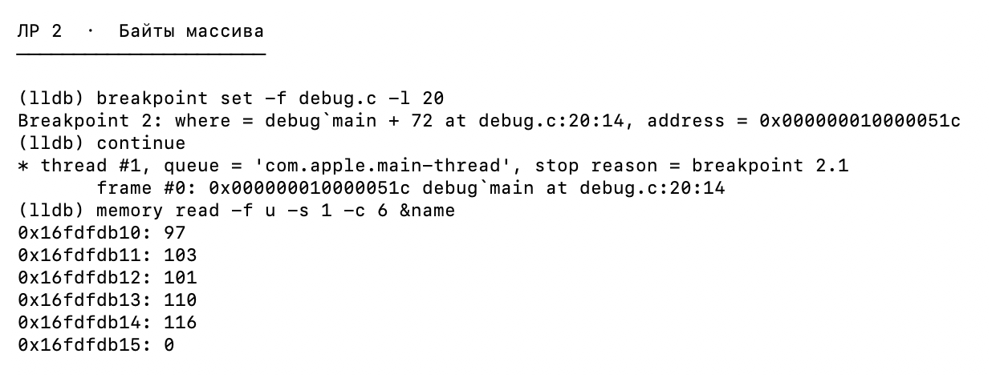
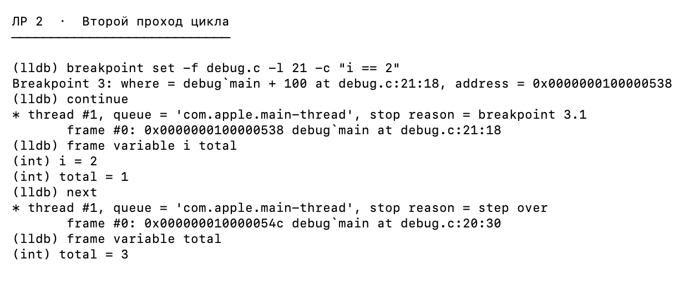
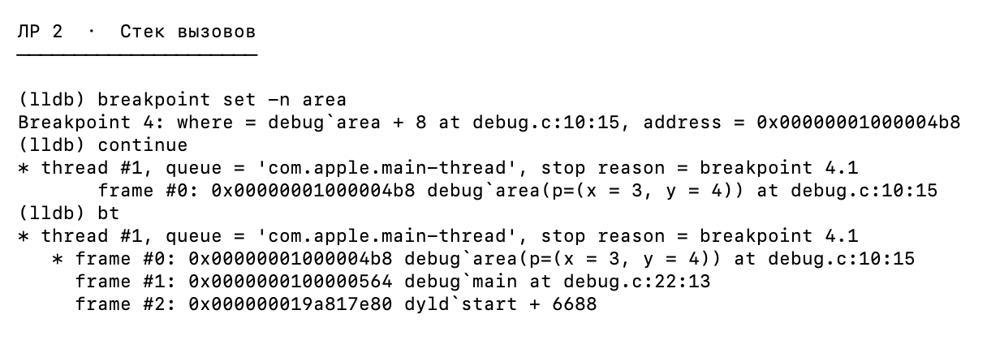
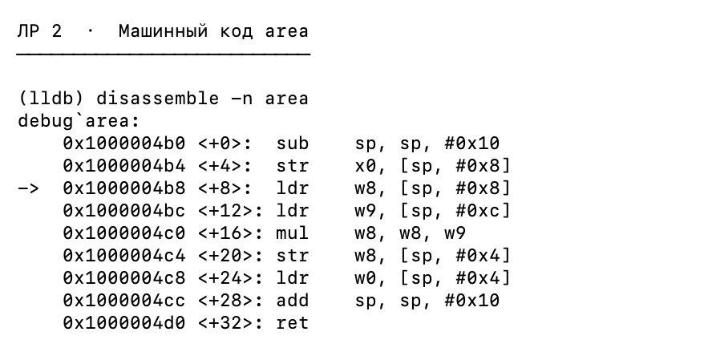
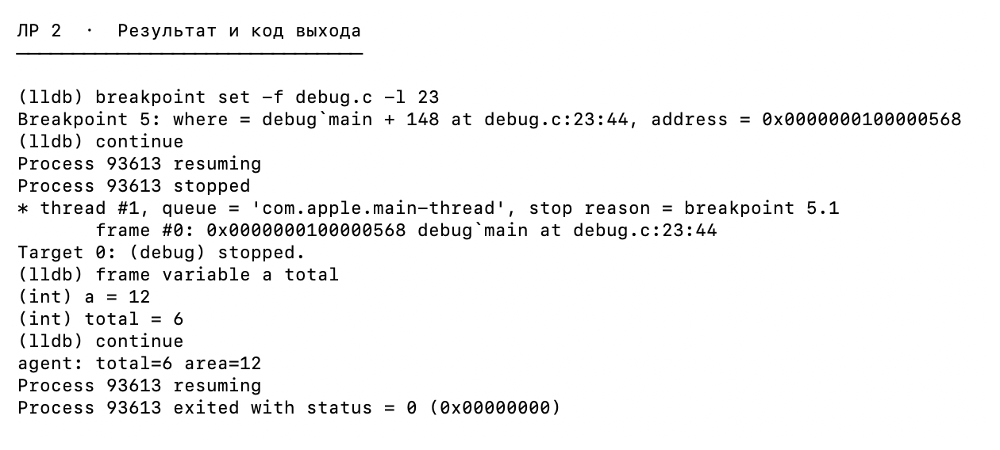

# ЛР 2. Программа в отладчике

Система: macOS 27, Apple Silicon (arm64) · отладчик: LLDB

## Остановка и переменные
Программа без отладчика напечатала: `agent: total=6 area=12`
Точка останова на строке 15.
До строки 15: p.x = -94881664, p.y = 1, total = 1.
После строки 15: p.x = 3, p.y = 4.
Строку 16 отладчик пропустил, потому что `char name[8];` только объявляет массив — машинных команд для неё нет.
name[0] = 97 (код буквы `a`), завершающий ноль в ячейке [5].

## Цикл и функция
На кадре цикла: i = 2, total = 1; после следующего шага total = 3.
В стеке внутри area строк: 3 (debug!area, debug!main и служебная start без исходного кода), сверху функция area.
Команда умножения в машинном коде: `mul w8, w8, w9`.
Перед printf: a = 12, total = 6.
Код завершения программы: 0.

## Сеанс LLDB на Mac, 18 ноября 2026 года

Снимки сделаны при повторной сборке с отладочной информацией и без оптимизации. Перед присваиванием в строке 15 отладчик прочитал остаточные значения из стека. После шага поля приняли значения 3 и 4. Шесть байтов строки равны 97, 103, 101, 110, 116 и 0. На втором проходе сумма изменилась с 1 до 3. Команда bt показала три кадра, а disassemble — инструкцию ARM64 mul. Перед выводом total равнялся 6, a — 12. Статус завершения — 0.

## Помощник ИИ (Р1)

Вопрос: «Почему до выполнения строки 15 в p.x лежит случайное число?».

До присваивания у полей структуры нет определённого значения. Отладчик может показать оставшиеся в стеке байты. После шага через строку 15 значения соответствуют инициализатору.

## Снимки терминала

