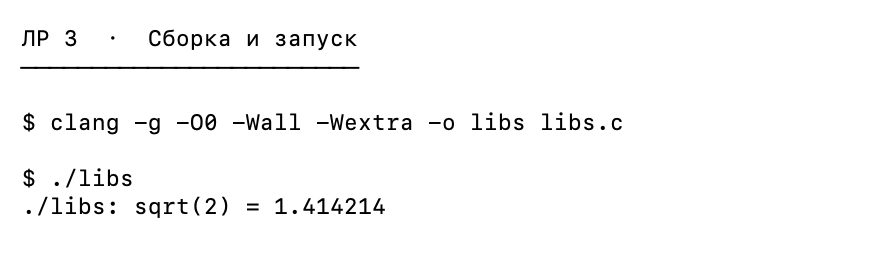
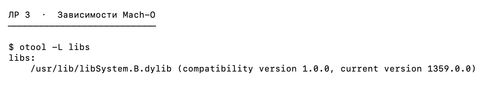
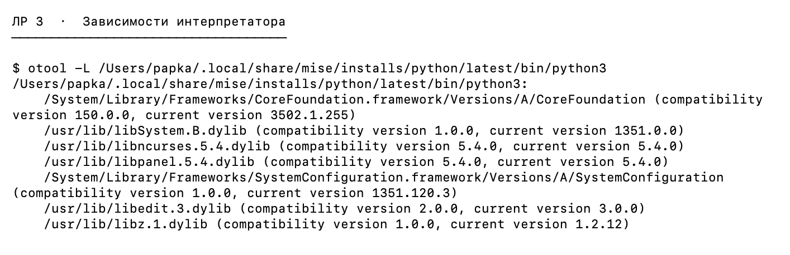
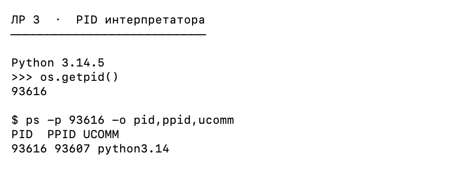
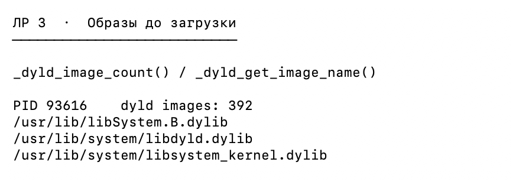
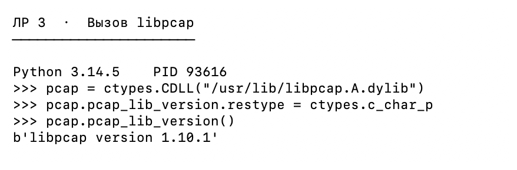
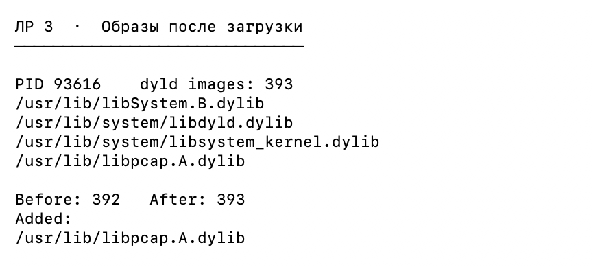

# ЛР 3. Библиотеки программы

Система: macOS 27, Apple Silicon (arm64)

## Библиотеки файла
Программа напечатала: `./libs: sqrt(2) = 1.414214`
Команда для списка библиотек файла: `otool -L libs`
Библиотеки libs: одна — `/usr/lib/libSystem.B.dylib`
Почему в списке нет отдельной математической библиотеки (или почему она есть): в macOS функции C, математика (`sqrt`) и системные вызовы собраны в одну библиотеку libSystem, отдельной libm подключать не нужно.
Где лежит интерпретатор Python (файл или библиотека): в библиотеке — файл `python3` из Command Line Tools только обёртка, `otool -L` показывает `@executable_path/../Python3` (Python 3.9.6).

## Библиотеки процесса
PID Python: 45244
Библиотек в процессе до ctypes.CDLL: 203, после: 205
Загруженная библиотека и её полный путь: `/usr/lib/libpcap.A.dylib` (вторая новая — `/usr/lib/libffi.dylib`, её подтянул `import ctypes`)
Функция вернула: `b'libpcap version 1.10.1'`

## Повторный запуск на Mac, 18 ноября 2026 года

В этом запуске использован Python 3.14.5 из mise. В списке otool для его исполняемого файла видны CoreFoundation, libSystem и другие системные библиотеки. Отдельной зависимости от Python.framework или libpython в этом списке нет. У программы libs по-прежнему одна прямая зависимость, libSystem.B.dylib.

Внутри одного интерпретатора (PID 93616) список загруженных образов прочитан через функции dyld. ctypes был импортирован до первого измерения. До загрузки libpcap было 392 образа, после — 393. Добавился /usr/lib/libpcap.A.dylib. Вызов pcap_lib_version вернул b'libpcap version 1.10.1'.

## Помощник ИИ (Р1)

Вопрос: «Чем статическая компоновка отличается от динамической?».

При статической компоновке нужный объектный код попадает в исполняемый файл. При динамической загрузчик подключает библиотеку отдельно. В опыте otool показывает привязку к libSystem, а список dyld изменяется после загрузки libpcap во время выполнения.

## Снимки терминала

