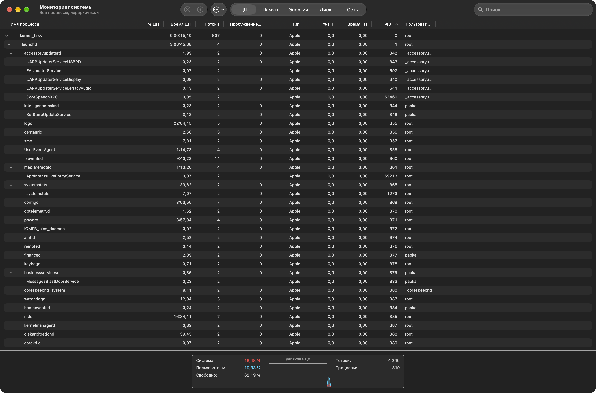
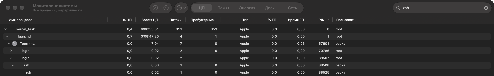
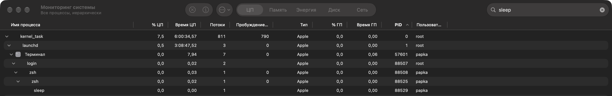
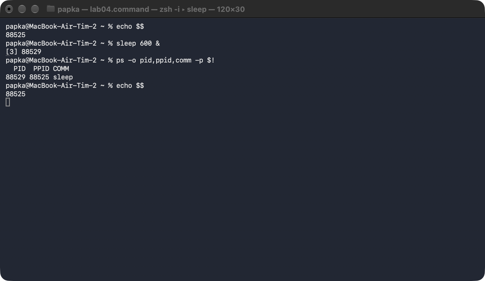
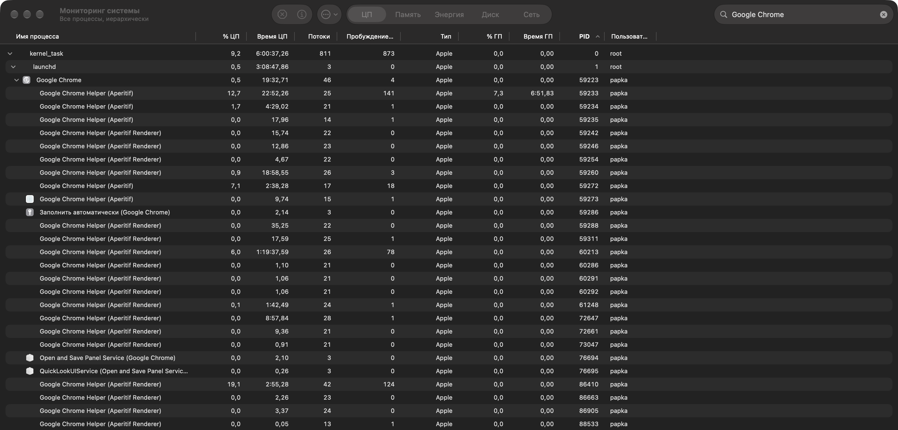
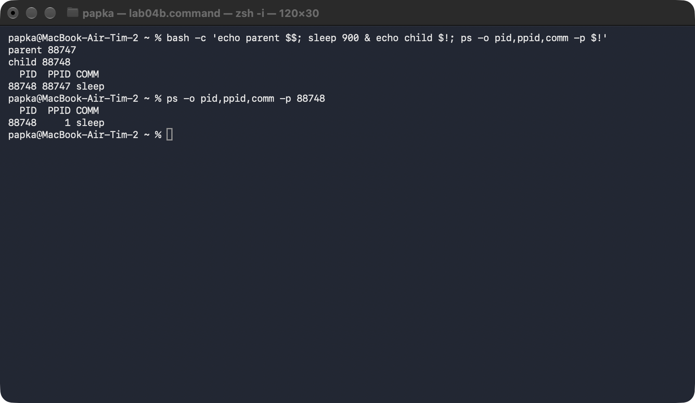
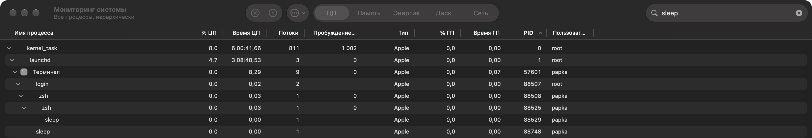

# ЛР 4. Дерево процессов

Система: macOS 27, Apple Silicon (arm64)

## Дерево
Процесс в начале дерева и его номер: `kernel_task` — 0 (ядро), под ним `launchd` — 1, от него идут все остальные процессы
Цепочка родителей терминала (имя и номер): `zsh` 88525 → `zsh` 88508 (входная оболочка окна) → `login` 88507 → `Терминал` 57601 → `launchd` 1 → `kernel_task` 0
Дочерний процесс: номер 88529 (`sleep 600 &`), родитель 88525 (`zsh`, то же число печатает `echo $$`)
Команда, которой проверен родитель: `ps -o pid,ppid,comm -p $!` → `88529 88525 sleep`
Процессов у браузера и имя процесса вкладок: 27 — `Google Chrome` 59223 и 26 дочерних; вкладки и страницы работают в `Google Chrome Helper (Aperitif Renderer)` (18 штук), ещё 5 `Google Chrome Helper (Aperitif)` — GPU, сеть, хранилище

## Сирота
Номер сироты: 88748 (`sleep 900`, запущен из `bash -c '… sleep 900 & …'`)
Номер родителя до и после завершения настоящего родителя: до — 88747 (`bash`, напечатал `parent 88747`), после — 1 (`launchd`)
Где сирота стоит в дереве: `ps` показывает PPID 1, а монитор рисует `sleep` 88748 прямо под `Терминал` 57601, рядом с `login`, а не под оболочкой: монитор строит дерево по ответственному процессу (приложению, которое его запустило), а не только по PPID

Не получилось: —

## Снимки экрана

### 1. Начало дерева процессов
Шаг 1. Видно: дерево процессов в мониторе: первые процессы системы и их номера.

### 2. Терминал и его родители
Шаг 2. Видно: ветка дерева от процесса терминала вверх до процесса системы.

### 3. Дочерний процесс терминала
Шаг 3. Видно: запущенный из терминала процесс под оболочкой терминала.

### 4. Родитель по команде
Шаг 4. Видно: вывод команды с номером процесса и номером его родителя.

### 5. Процессы браузера
Шаг 5. Видно: раскрытая ветка браузера с дочерними процессами.

### 6. Процесс без родителя
Шаг 6. Видно: команда запуска и номер родителя у оставшегося процесса.

### 7. Сирота в дереве
Шаг 7. Видно: тот же процесс в дереве монитора на новом месте.

