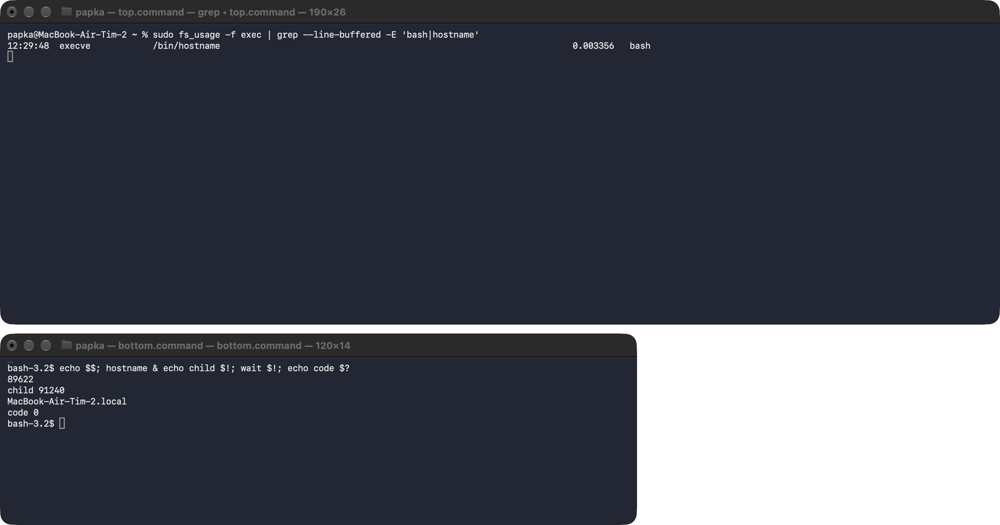
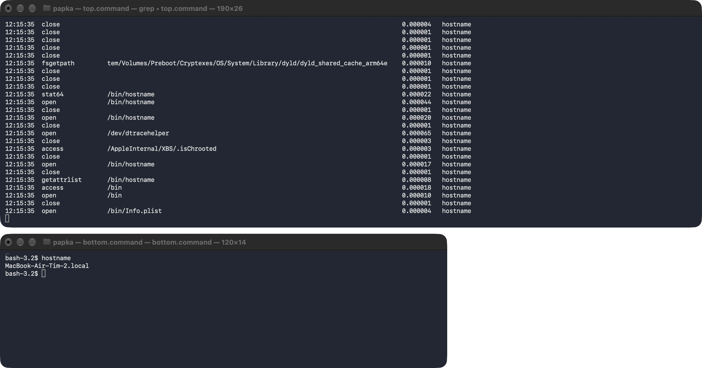
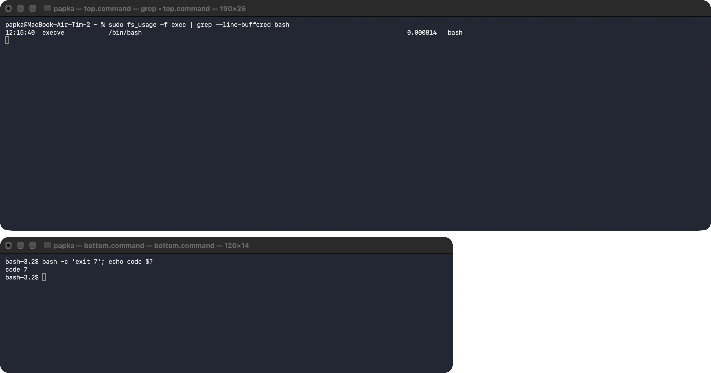
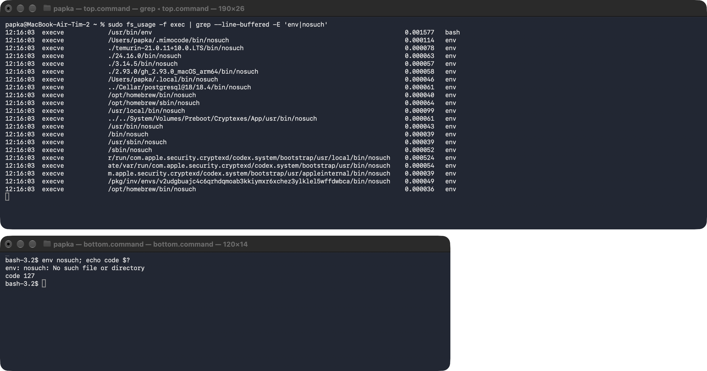
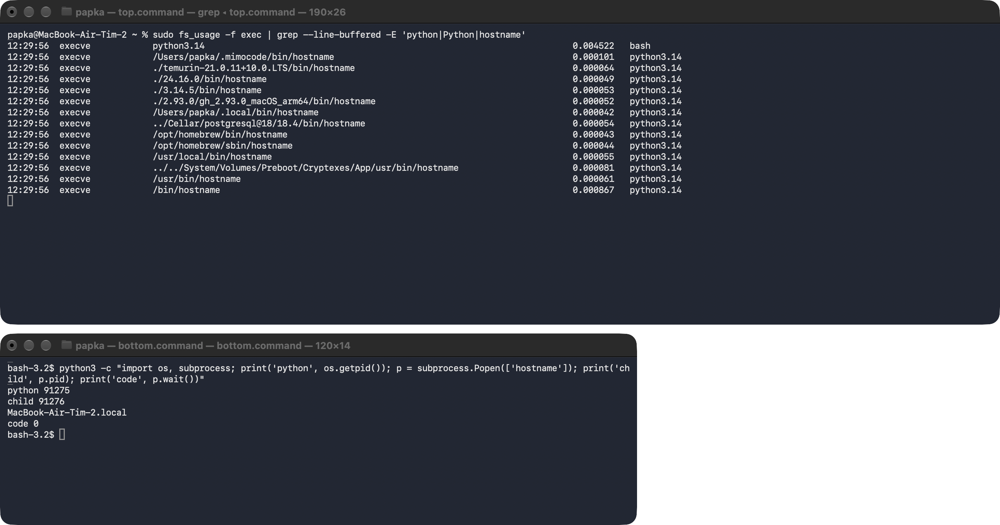

# ЛР 5. Рождение процесса

Система: macOS 27, Apple Silicon (arm64)
Программа записи: `fs_usage` (`sudo fs_usage -f exec`, `-f pathname`), во втором окне — `bash` 3.2

## Рождение
Родитель (имя и номер): `bash` 89622 (`echo $$`)
Номер нового процесса: 91240 (`$!` после `hostname &`)
Событие или вызов, которым создан процесс: `fork` в `bash` создаёт копию оболочки, копия делает `execve /bin/hostname` — в записи строка `execve /bin/hostname … bash` (процесс ещё называется `bash`, после `execve` в нём уже код `hostname`)
Библиотек загружено и первая из них: в файле записана одна — `/usr/lib/libSystem.B.dylib` (`otool -L /bin/hostname`); при запуске `dyld` берёт её и всё, что она тянет, из общего кэша `dyld_shared_cache_arm64e` — в записи `-f pathname` видно открытие кэша и самого `/bin/hostname`

## Завершение
Код завершения у ребёнка и у родителя: ребёнок `bash -c 'exit 7'` завершился с кодом 7, родитель получил 7 в `$?` (`code 7`)
Программа nosuch: папок проверено 20 (по одному `execve` на каждую папку `PATH`), ошибка `No such file or directory` (ENOENT, 2), код 127

## Запуск из Python
Номер Python и номер ребёнка: Python 91275, ребёнок 91276, код 0
Чем запуск из Python отличается от запуска из оболочки: `bash` сам находит `/bin/hostname` в `PATH` и делает один `execve` с полным путём; `subprocess` в Python пробует `execve` по очереди в каждой папке `PATH` (13 неудачных попыток до `/bin/hostname`), а процесс до `execve` называется `python3.14`, а не `bash`

Не получилось: —

## Снимки экрана

### 1. Рождение процесса
Шаг 1. Видно: запись запуска `hostname`: родитель создаёт процесс, у нового процесса номер родителя.

### 2. Библиотеки нового процесса
Шаг 2. Видно: библиотеки, которые загрузил `hostname`, и первая из них.

### 3. Код завершения 7
Шаг 3. Видно: завершение ребёнка с кодом 7 и тот же код у родителя.

### 4. Программы нет
Шаг 4. Видно: поиск `nosuch` по папкам из PATH и ошибка «не найдено».

### 5. Запуск из Python
Шаг 5. Видно: Python создаёт процесс `hostname`: номер Python и номер ребёнка.

