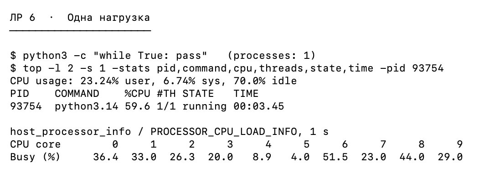
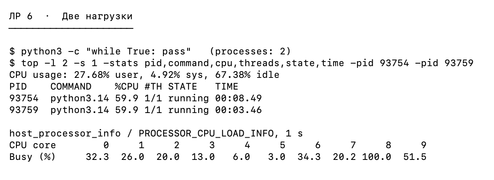
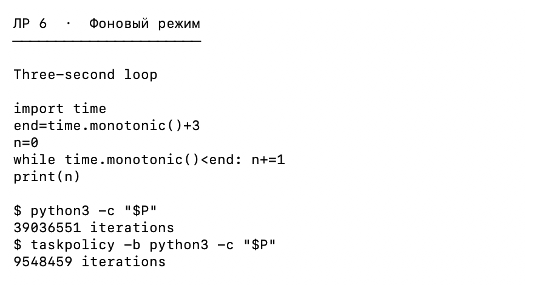
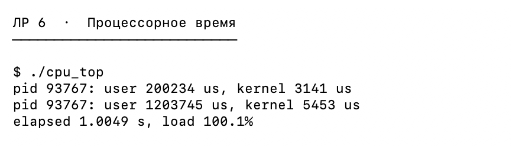

# ЛР 6. Кто загружает процессор

macOS 27.0, Apple Silicon, 10 логических процессоров. Замеры выполнены 18 ноября 2026 года.

## Одна и две нагрузки

| Нагрузка | PID и % CPU по top | Общая загрузка системы (user + sys) |
|---|---|---|
| Один процесс Python | 93754 — 59,6% | 29,98% |
| Два процесса Python | 93754 — 59,9%, 93759 — 59,9% | 32,60% |

По разности двух счётчиков host_processor_info с интервалом в секунду в первом опыте наиболее заняты ядра 6 (51,5%) и 8 (44,0%). Во втором ядро 8 достигло 100%, ядро 9 — 51,5%. Эти проценты включают работу остальных процессов. Номера ядер отражают конкретный интервал, за который планировщик мог переносить поток.

## Фоновый режим

За три секунды обычный процесс сделал 39 036 551 оборот, а процесс, запущенный через taskpolicy -b, — 9 548 459. В обычном режиме тот же цикл выполнил примерно в 4,1 раза больше работы. На macOS этот опыт меняет класс фоновой работы. Привязка к конкретному ядру не задавалась.

## Проверка по процессорному времени

Для отдельного нагрузочного процесса PID 93767 первый замер дал 200 234 мкс в пользовательском режиме и 3141 мкс в ядре. Второй дал 1 203 745 и 5453 мкс соответственно. За 1,0049 с процесс получил 1 005 823 мкс процессорного времени. Загрузка составила 100,1% одного ядра с учётом погрешности границ интервала. Процент показывает долю времени выполнения. Число операций за это время также зависит от ядра, частоты и самой операции.

## Снимки терминала

