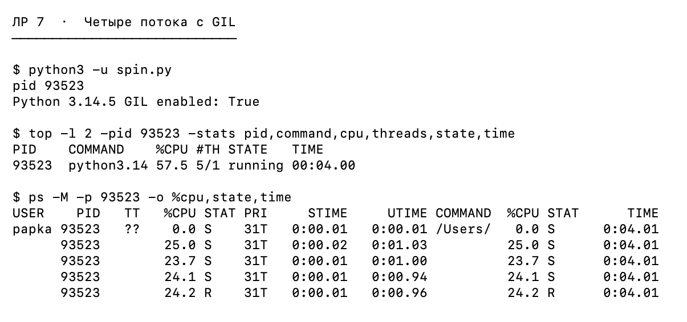
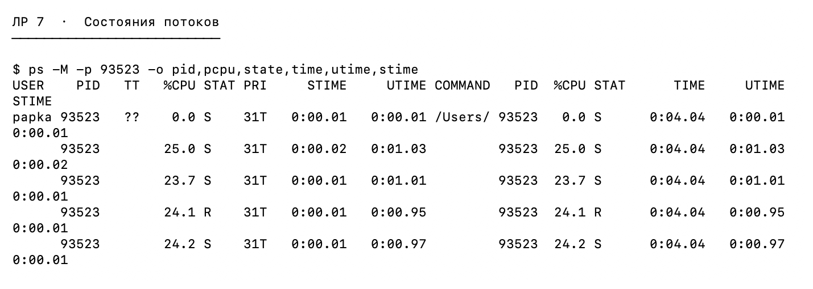
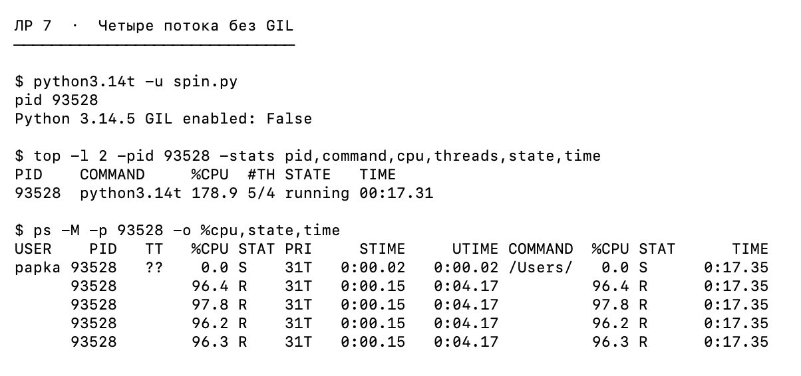
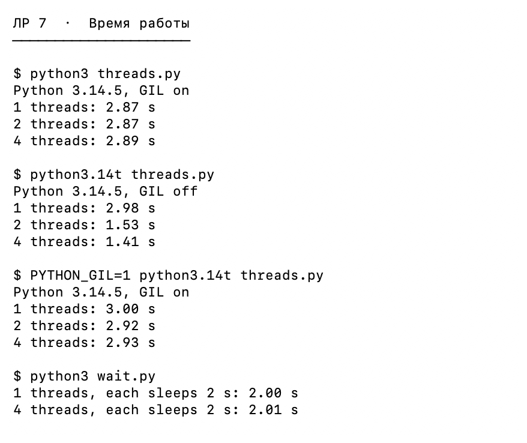

# ЛР 7. Потоки Python и GIL

macOS 27.0, Apple Silicon, 10 логических процессоров. Обе сборки Python версии 3.14.5. Состояние GIL проверено через sys._is_gil_enabled().

## Четыре вычислительных потока

С GIL у процесса PID 93523 было пять потоков, включая главный. Снимок top показал 57,5% CPU и один выполняющийся поток. В отдельном снимке ps рабочие потоки получили примерно по 24–25% за свой интервал наблюдения. Они по очереди исполняли код Python.

В сборке без GIL top показал для PID 93528 178,9% и четыре выполняющихся потока из пяти. В ps все четыре рабочих потока имели состояние R и значения 96,4%, 97,8%, 96,2% и 96,3%. У top и ps разные интервалы усреднения.

## Одинаковый объём вычислений

Каждая строка соответствует 200 млн декрементов, распределённым между указанным числом потоков.

| Интерпретатор | 1 поток | 2 потока | 4 потока |
|---|---:|---:|---:|
| Обычная сборка, GIL включён | 2,87 с | 2,87 с | 2,89 с |
| Свободнопоточная сборка, GIL выключен | 2,98 с | 1,53 с | 1,41 с |
| Та же сборка с PYTHON_GIL=1 | 3,00 с | 2,92 с | 2,93 с |

Без GIL четыре потока закончили одну и ту же работу примерно в 2,1 раза быстрее одного потока этой сборки. При включённом GIL сопоставимого ускорения не было.

Один sleep(2) занял 2,00 с, четыре параллельных — 2,01 с. Во время сна поток освобождает GIL, поэтому интервалы ожидания перекрываются.

## Снимки терминала

