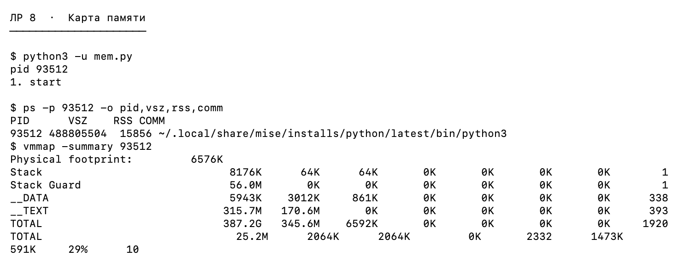
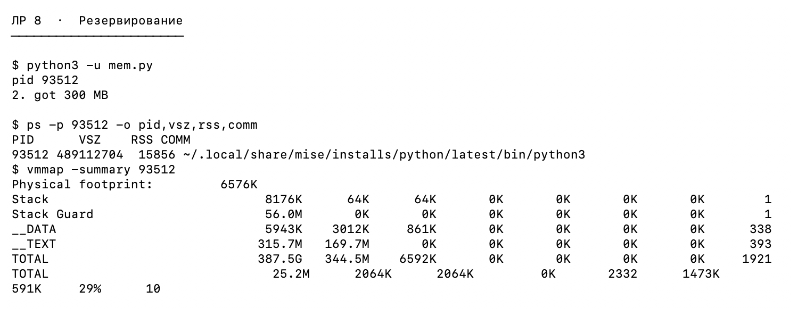
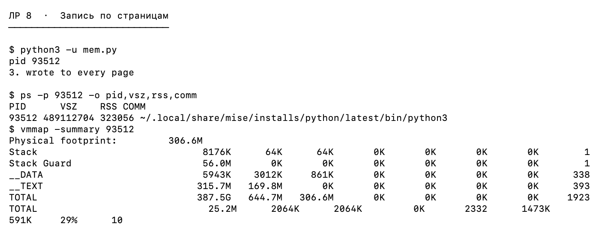
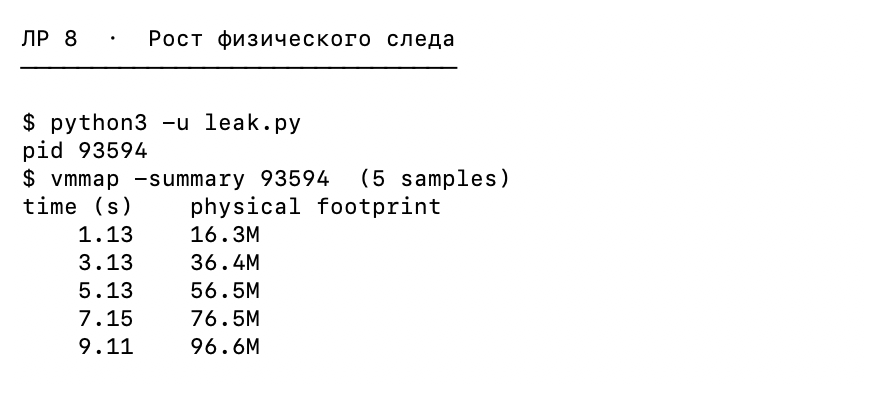

# ЛР 8. Карта памяти

macOS 27.0, Apple Silicon. Этапы mem.py сняты для одного PID 93512. ps сообщает виртуальный размер VSZ и резидентный размер RSS в КиБ. vmmap отдельно показывает физический след процесса.

| Этап | VSZ, КиБ | RSS, КиБ | Физический след |
|---|---:|---:|---:|
| Старт | 488 805 504 | 15 856 | 6576 КиБ |
| Получен диапазон 300 МиБ | 489 112 704 | 15 856 | 6576 КиБ |
| Выполнена запись в каждую страницу | 489 112 704 | 323 056 | 306,6 МиБ |
| Вызван close | 488 805 504 | 15 856 | 6576 КиБ |

После mmap виртуальный размер вырос ровно на 307 200 КиБ. Физические страницы понадобились при первой записи, тогда на те же 307 200 КиБ вырос RSS. После закрытия отображения оба показателя вернулись к исходным значениям. В карте vmmap видны стек и его защитная область, сегменты кода __TEXT и данных __DATA. В общий размер также входят отображения библиотек и выделения кучи.

## Накопление памяти

У leak.py (PID 93594) физический след рос от 16,3 до 36,4, 56,5, 76,5 и 96,6 МиБ с интервалом около двух секунд. За восемь секунд прирост составил 80,3 МиБ, в среднем 20,1 МиБ за две секунды. Список kept сохраняет ссылку на каждый новый буфер, поэтому память остаётся занятой.

## Снимки терминала

