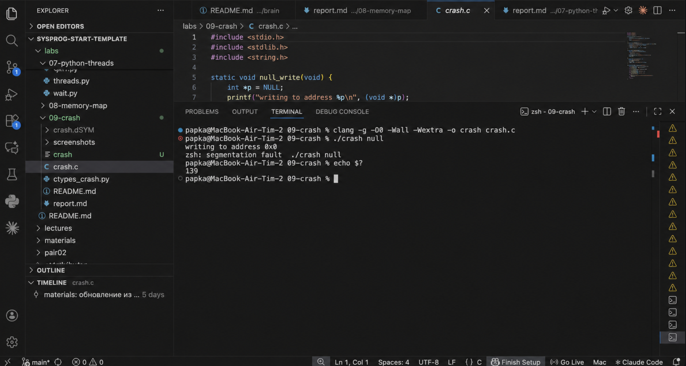
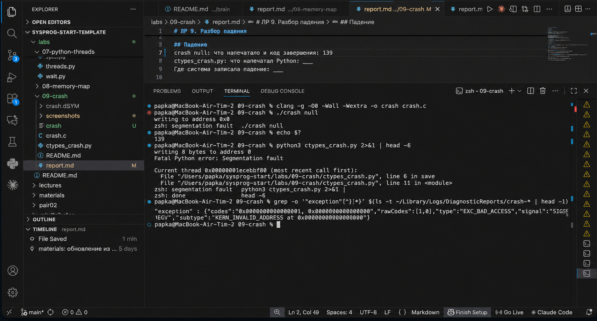
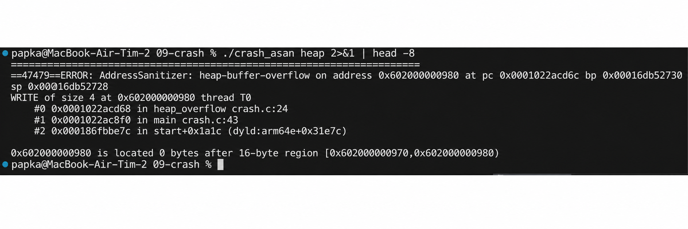
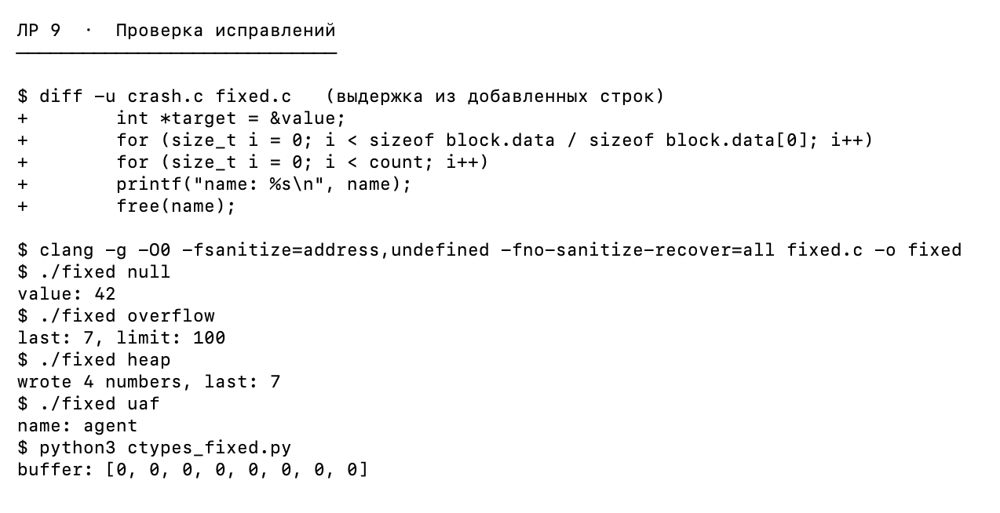

# ЛР 9. Разбор падения

Система — macOS 27.0, Apple Silicon. Компилятор — Apple Clang 21.0.0.

## Падение программы на C

Перед падением программа вывела `writing to address 0x0`. Оболочка сообщила `segmentation fault`, код завершения — 139. Это 128 + 11, где 11 — номер сигнала SIGSEGV.

## Падение Python

На кадре с диагностики Python вывел `writing 8 bytes to address 0`, затем `Fatal Python error: Segmentation fault`. В стеке виден вызов функции `save` в `ctypes_crash.py`. Нативная функция, вызванная через `ctypes`, работает в процессе интерпретатора, поэтому ошибка доступа может завершить весь процесс Python.

На том же кадре из каталога `~/Library/Logs/DiagnosticReports/` показана запись `EXC_BAD_ACCESS` с сигналом `SIGSEGV`. Выбран файл `crash-*`, поэтому по этой записи нельзя подтвердить, что системный отчёт относится именно к процессу Python.

## Ошибки доступа к памяти

На кадре с AddressSanitizer видна ошибка `heap-buffer-overflow`. Отчёт указывает на запись 4 байтов сразу за границей выделенного блока размером 16 байтов. Место ошибки — `crash.c:24`, функция `heap_overflow`.

При выходе за границу массива программа может попасть в память, доступную процессу. Поэтому такая запись способна повредить соседние данные без немедленного падения. Результат запуска без санитайзера на кадре отсутствует.

Статический анализ Clang также обнаружил запись через нулевой указатель в строке 8 и чтение освобождённой памяти в строке 33. Для `fixed.c` предупреждений не было.

## Исправления и проверка

| Режим | Что исправлено | Результат |
| --- | --- | --- |
| `null` | Указатель направлен на существующую переменную | `value: 42` |
| `overflow` | Цикл ограничен длиной массива | Последний элемент равен 7, `limit` остался 100 |
| `heap` | Выделение памяти и цикл используют одно число элементов, результат `malloc` проверяется | Записано 4 элемента |
| `uaf` | Строка выводится до освобождения памяти | `name: agent` |

В исправленном примере Python буфер создаётся через `ctypes`, а очистка использует его фактический размер. После очистки все восемь байтов равны нулю.

Все четыре режима исправленной программы завершились с кодом 0 под AddressSanitizer и UndefinedBehaviorSanitizer. Исправленный вариант Python также завершился с кодом 0.

