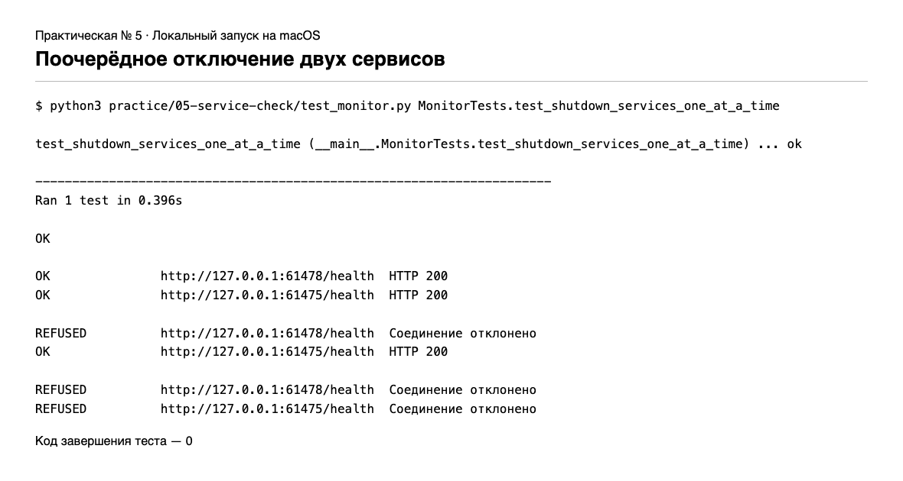
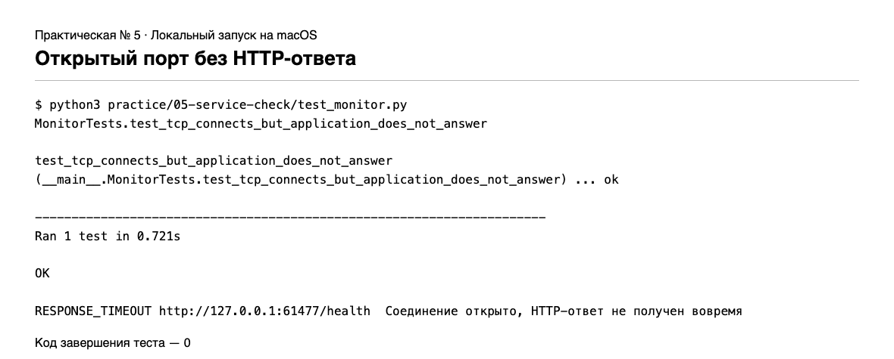
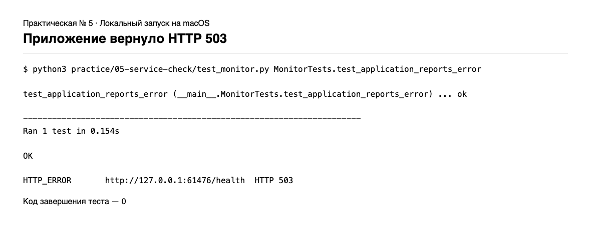

# Практическая работа № 5. Проверка доступности сервисов

Программа принимает адреса HTTP- и HTTPS-сервисов, подключается к их портам и отправляет GET на указанный путь. Для проверки состояния приложения указывают адрес, который возвращает HTTP 2xx, когда сервис готов, например /health.

Нужен Python 3. Внешних зависимостей нет. Команды ниже запускаются из корня репозитория.

## Запуск

    python3 practice/05-service-check/monitor.py --timeout 2 http://127.0.0.1:8001/health http://127.0.0.1:8002/health

Аргумент --timeout задаёт тайм-аут сетевой операции в секундах. При успехе всех проверок программа возвращает код 0, при сбое хотя бы одной — 1. Остальные адреса проверяются и после сбоя.

| Результат | Что произошло |
| --- | --- |
| OK | Приложение вернуло HTTP 2xx |
| REFUSED | Подключение к порту отклонено |
| CONNECT_TIMEOUT | Не удалось подключиться за отведённое время |
| CONNECT_ERROR | Другая ошибка подключения, например имя хоста не разрешилось |
| RESPONSE_TIMEOUT | Соединение установлено, HTTP-ответ вовремя не пришёл |
| NO_RESPONSE | Сервис закрыл соединение, не отправив HTTP-ответ |
| RESPONSE_ERROR | При обмене произошла ошибка или ответ не распознан как HTTP |
| HTTP_ERROR | Сервис ответил, но вернул код за пределами диапазона 2xx. Перенаправления видны как HTTP 3xx |

## Испытания на localhost

    python3 practice/05-service-check/test_monitor.py

Тесты поднимают серверы на свободных портах loopback-интерфейса 127.0.0.1. Каждый раз запускается та же команда мониторинга, что и при обычной проверке. Тесты сверяют результат для каждого сервиса и код завершения команды.

| Опыт | Сервис A | Сервис B | Код завершения |
| --- | --- | --- | --- |
| Оба приложения работают | OK, HTTP 200 | OK, HTTP 200 | 0 |
| Остановили A, B ещё работает | REFUSED | OK, HTTP 200 | 1 |
| Затем остановили B | REFUSED | REFUSED | 1 |
| Сервер принял соединение и прочитал запрос, ответа нет | RESPONSE_TIMEOUT | | 1 |
| Сервер ответил кодом HTTP 503 | HTTP_ERROR | | 1 |

Результаты получены на macOS. Принятое TCP-соединение показывает, что порт доступен. Проверка HTTP-ответа позволила отдельно обнаружить зависший обработчик и приложение, которое вернуло ошибку 503. Все три автоматических теста пройдены.

ИИ использован для подготовки кода и автоматических тестов.

## Снимки локальных испытаний

Снимки показывают журнал трёх реальных запусков тестов на macOS.

### Поочерёдное отключение сервисов

### Открытый порт без ответа

### Ошибка приложения

